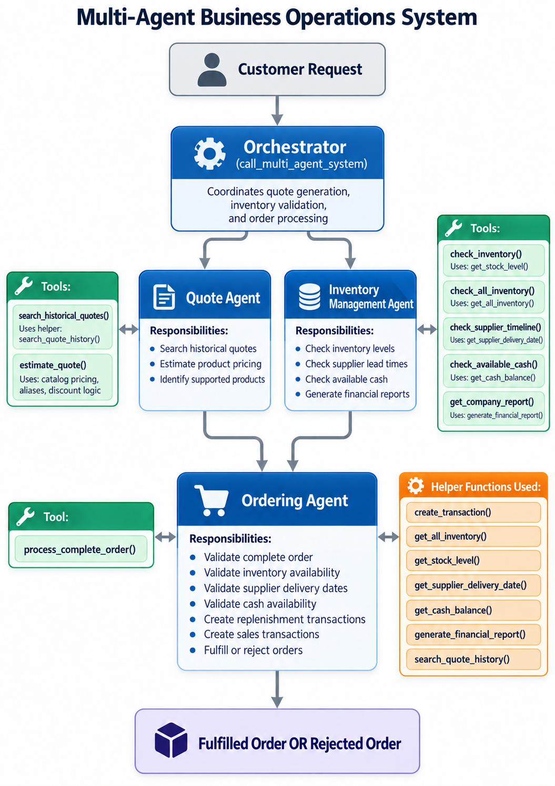

# Multi-Agent Business Operations System

A Python multi-agent prototype that coordinates quoting, inventory analysis, supplier timing, financial validation, and customer order processing.

## Overview

A distributor must evaluate pricing, stock availability, delivery timing, and replenishment funding before accepting an order.

This project combines specialized AI agents with deterministic business tools to:

- Generate preliminary quotes
- Retrieve historical quote examples
- Resolve customer product terminology
- Validate inventory and supplier timing
- Check available cash for replenishment
- Fulfill or reject complete orders
- Record purchases and sales
- Generate financial reports and reconcile cash movements

## Architecture



| Component | Responsibility |
|---|---|
| Orchestrator | Delegates requests to specialist agents and coordinates the workflow |
| Quote Agent | Searches historical quotes and estimates preliminary item prices |
| Inventory Management Agent | Checks inventory, supplier timelines, available cash, and financial reports |
| Ordering Agent | Extracts order details and invokes the authoritative order-processing tool |

The `process_complete_order()` tool applies final business rules and records approved transactions. Customer responses are generated directly from its recorded result.

## Key Features

- **Quote generation:** Historical retrieval, catalog pricing, product aliases, and quantity discounts
- **Inventory analysis:** Transaction-based stock calculations and shortage identification
- **Supplier validation:** Quantity-based lead times checked against delivery deadlines
- **Financial controls:** Cash checks before replenishment and proportional revenue allocation
- **Order processing:** Complete-order acceptance or rejection with recorded reasons
- **Evaluation:** Saved simulation outcomes and cash reconciliation checks

## Technology Stack

- Python
- Smolagents
- OpenAI-compatible API
- SQLite
- SQLAlchemy
- Pandas and NumPy
- python-dotenv

## Getting Started

Keep the project files in the same directory.

Install dependencies:

```bash
python -m pip install -r requirements.txt
```

The current implementation uses the course-provided OpenAI-compatible endpoint. Create a local `.env` file containing:

```text
UDACITY_OPENAI_API_KEY=your_api_key
```

Do not commit the `.env` file.

Run from the project directory:

```bash
python multi_agent_system.py
```

Each run resets `munder_difflin.db` and regenerates the simulation results. Model access requires valid credentials and network connectivity.

## Project Files

| File | Description |
|---|---|
| `README.md` | Project overview and setup |
| `multi_agent_system.py` | Agents, tools, database helpers, and simulation |
| `design_notes.txt` | Architecture, business rules, and design decisions |
| `workflow_diagram.png` | Workflow visualization |
| `quote_requests.csv` | Historical customer requests |
| `quotes.csv` | Historical quotes paired with those requests |
| `quote_requests_sample.csv` | Sample requests for the simulation |
| `test_results.csv` | Recorded simulation outcomes |
| `requirements.txt` | Python dependencies |

Both historical CSVs are required for database initialization.

## Recorded Results

The saved simulation processed 20 requests:

- **8 fulfilled**
- **5 rejected for unsupported products**
- **7 rejected because replenishment would miss the delivery deadline**

Results include order status, rejection reasons, transaction indicators, pricing, replenishment costs, and cash movements.

These are recorded simulation outcomes, not an automated test pass rate.

## Limitations

This is a local simulation prototype. Purchases and sales are recorded on the request date; inventory does not model physical shipment and arrival events.

Product attributes and packaging units need further validation. Database-level atomicity, duplicate-order protection, and concurrent processing require additional development.

## Future Enhancements

- Add automated business-rule and transaction tests
- Introduce explicit quantity-unit conversions
- Add demand forecasting and predictive replenishment
- Extend supplier selection and procurement capabilities
- Add operational dashboards and structured logging

## Background

Developed during a multi-agent systems course to demonstrate business-oriented agent orchestration and tool-based operational controls.

## Author

**Mark Schulze**
